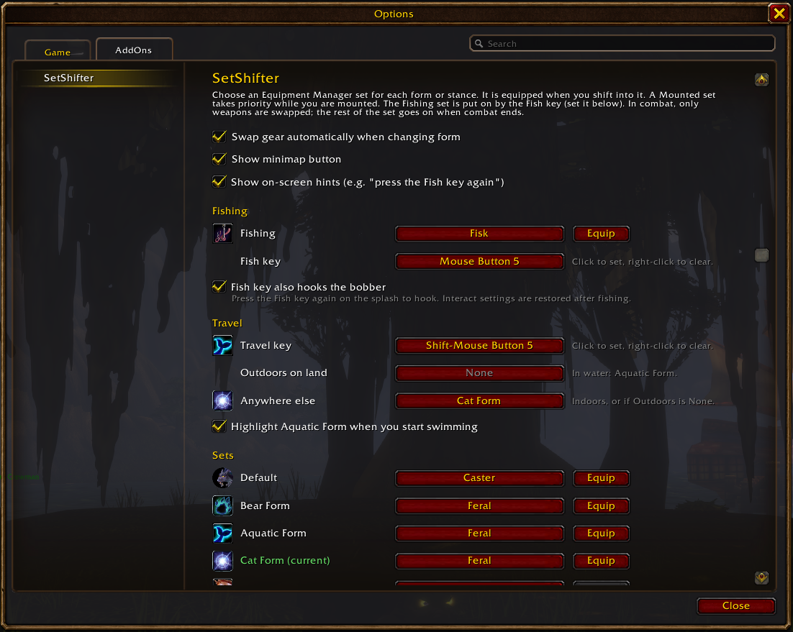

# SetShifter

A World of Warcraft addon that automatically equips your Equipment Manager sets when you shift forms, change stances, mount up or go fishing.

It works with any class that has a stance bar:

- **Druids:** switch to a feral set when you go into Cat Form and back to your healing set when you return to caster form.
- **Warriors:** put on a shield set when you enter Defensive Stance and a two-hander when you enter Battle or Berserker Stance.
- **Priests:** put on a shadow set in Shadowform and a healing set when you leave it.
- **Rogues:** equip a dagger for Ambush when you enter Stealth and switch back when you leave it.
- **Paladins:** auras are on the stance bar, so each aura can have its own set.

Hunter aspects aren't on the stance bar in Classic, so hunters can't use SetShifter.

## Installation

Install SetShifter from [CurseForge](https://www.curseforge.com/wow/addons/setshifter) with the CurseForge app, or install it manually:

1. Download the zip from [CurseForge](https://www.curseforge.com/wow/addons/setshifter) or the [latest GitHub release](https://github.com/vpegado/SetShifter/releases/latest), and extract it into `World of Warcraft/<flavor>/Interface/AddOns/`. You can also clone this repository into `World of Warcraft/<flavor>/Interface/AddOns/SetShifter`.
2. Restart the game, or reload the UI with `/reload`.

## Usage

1. Create your gear sets in the Equipment Manager on the character panel.
2. Open **Options → AddOns → SetShifter**, or type `/setshifter`.
3. In the **Sets** section, pick a set for each form. **Default** is the no-form state (caster form for druids) and counts as a form too. Map it to a set if you want your gear to switch back when you leave a form. Warriors don't see this row because they are always in a stance.

SetShifter equips the set mapped to a form whenever you shift into that form.

### Mounted

The **Mounted** row lets you pick a set to wear while mounted, such as one with riding gloves, spurs or a Carrot on a Stick. While you're mounted it takes priority over your form's set, and your form's set goes back on when you dismount. Leave it at **None** to keep your gear unchanged when you mount.

### Fishing

The **Fishing** section of the settings lets you pick a set to fish in, with your fishing pole and any fishing gear. To use it, set a **Fish** key. In the SetShifter settings, click the **Fish key** button and press a key; right-click it to unbind. You can also set it under **Key Bindings → AddOns → SetShifter**. Either way, it's the same binding.

With the key bound:

1. The first press equips your Fishing set, and a message reminds you to press the key again.
2. The next press casts Fishing, and so does every press after that.

You need two presses because an addon can't equip the pole and cast in the same key press: the cast would fire before the pole is in your hand.

While you're fishing, your Fishing set takes priority over your form's set. Your form's set goes back on when:

- **You enter combat.** Your weapons are swapped back right away, and the rest of your gear after combat.
- **You mount or shift into a form.** Dropping out of a form to cast Fishing (for example from Cat Form) doesn't count.
- **You zone,** for example by hearthing or taking a portal.
- **You stop fishing for 60 seconds.** Change the delay with `/setshifter fishtimeout <seconds>`, or use `0` to turn it off.
- **You type `/setshifter stopfishing`.**

If your current form has no set, SetShifter puts back the set you were wearing before you started fishing. Casting Fishing from your spellbook or an action bar also counts as fishing, as long as a Fishing set is picked or bobber hooking is on.

#### Bobber hooking

Tick **Fish key also hooks the bobber** in the settings, or type `/setshifter hook`, to fish with one key:

1. Press the Fish key to cast.
2. When the bobber splashes, press the Fish key again to hook the fish.

While the bobber is out, the Fish key works as **Interact with Target**. SetShifter also widens the interact range so the bobber can be targeted, and shows the interact icon over it. Between casts, the key casts Fishing again.

These interact settings stay on for as long as you're fishing. When you stop fishing (combat, mounting, shifting into a form, zoning, the timeout or `/setshifter stopfishing`), they go back to exactly what they were before. They're also put back when you log out, and the next time you log in after a crash or disconnect.

Bobber hooking is off by default.

### Travel key (druids)

Druids get a **Travel** section in the settings with one key for getting around:

- **In water:** Aquatic Form.
- **Outdoors on land:** Travel Form. You can pick another form, or None.
- **Anywhere else** (indoors, or outdoors if you picked None): Cat Form. You can pick another form, or None.

Bind it from the **Travel key** button in the settings, or under **Key Bindings → AddOns → SetShifter**. Pressing it while you're already in that form shifts you back out, the same as clicking the form on your stance bar. Your gear swaps as usual when you change form.

When you start swimming, SetShifter lights up the Aquatic Form button on your stance bar and shows a short message with your Travel key. If a bar addon (such as Bartender or ElvUI) hides the default stance bar, you get the message but not the highlight. To turn this off, untick **Highlight Aquatic Form when you start swimming**.

Addons can't change your form by themselves, because WoW requires a key press or click for every form change. So SetShifter can't shift you into Aquatic Form automatically; the Travel key and the hint make it a single press.

### Minimap button

The minimap button shows the icon of your current set. If no set is equipped, it shows your current form's icon instead.

- **Click** to open the settings.
- **Drag** to move it around the minimap edge.
- **Hover** to see your current form and set.

To hide it, untick **Show minimap button** in the settings, or type `/setshifter minimap`.

### Notes

- **Combat:** armor can't be changed during combat, but weapons can. If you shift while in combat, SetShifter swaps the set's weapons right away (main hand, off hand/shield and ranged). It equips the rest of the set for your current form as soon as combat ends.
- **Mapped by name:** forms are mapped by their spell name, not their position on the stance bar. Your mappings keep working when talents add or remove forms, such as Moonkin Form.
- **On-screen hints:** short light-blue messages, such as the reminder to press the Fish key again or the Aquatic Form hint, appear where WoW shows error messages. To turn them off, untick **Show on-screen hints** in the settings. The Aquatic Form highlight on the stance bar has its own checkbox.
- **Login:** logging in never swaps your gear.
- **Per character:** each character has its own SetShifter settings. The Fish and Travel keys follow WoW's own setting: they're per character if **Character Specific Key Bindings** is ticked in Key Bindings, and account-wide otherwise.

## Slash commands

`/sshift` works as a short alias for `/setshifter`.

| Command | Description |
| --- | --- |
| `/setshifter` | Open the settings panel |
| `/setshifter list` | Show which set is mapped to each form, Mounted and Fishing, and your Fish key |
| `/setshifter equip` | Equip the set for your current form (or Mounted, if you're mounted) now |
| `/setshifter on` / `off` | Turn automatic swapping on or off |
| `/setshifter minimap` | Show or hide the minimap button |
| `/setshifter hook` | Turn bobber hooking with the Fish key on or off |
| `/setshifter stopfishing` | Stop fishing and put your gear and interact settings back now |
| `/setshifter fishtimeout <seconds>` | Stop fishing after this long without a cast (`0` = never; default 60) |

## License

[MIT](LICENSE)
